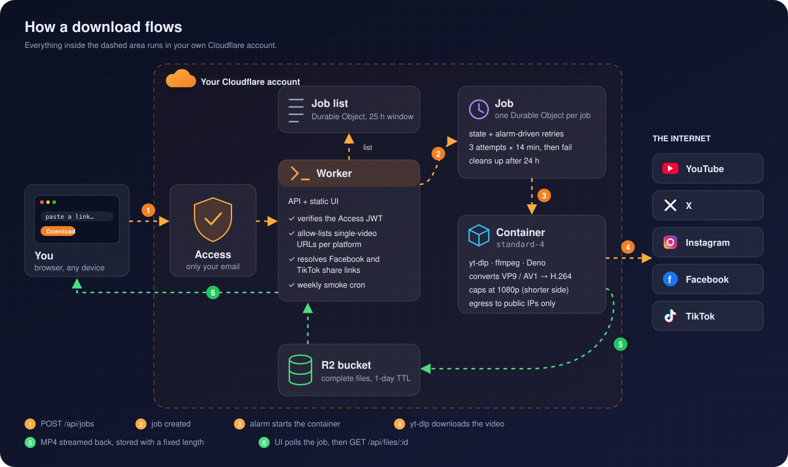
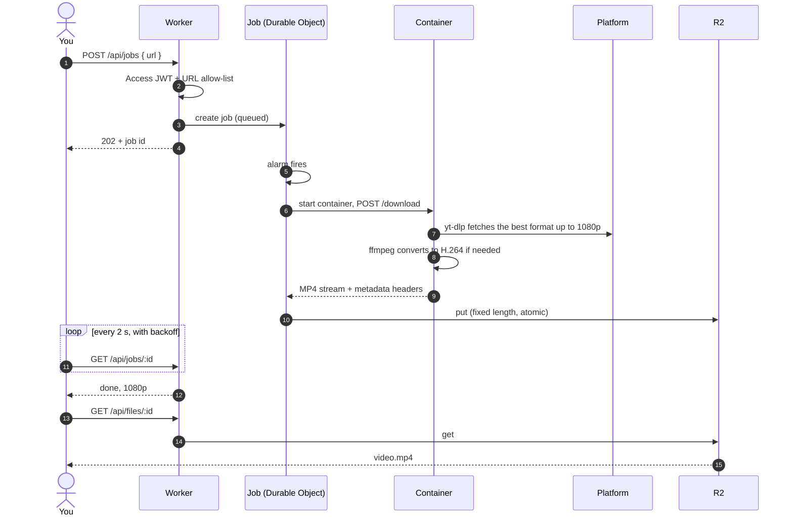
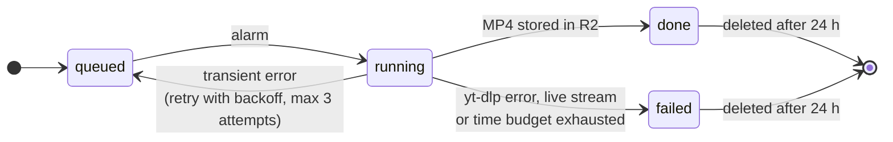

<p align="center">
  
</p>

<p align="center">
  <a href="https://github.com/guifav/video-downloader/actions/workflows/ci.yml"></a>
  <a href="LICENSE"></a>
  
  
  <a href="CONTRIBUTING.md"></a>
</p>

<p align="center">
  <b>Your own private video downloader. No ads, no shady sites, no server to babysit.</b><br>
  Deploy it once to your Cloudflare account, log in with your email, paste a link.
</p>

---

## Why

Most "download this video" websites are slow, full of ads, and send your links to who knows where. Running yt-dlp yourself works, but you need a terminal, ffmpeg, and a machine that is always on, and it does not help when you are on your phone.

**video-downloader** puts yt-dlp behind a tiny web page that only you can open. It runs entirely on Cloudflare's serverless platform:

- nothing keeps running while nobody is downloading;
- every download gets a fresh, isolated container;
- files delete themselves after a day.

## Features

| | |
|---|---|
| **Paste and go** | One input, one button. Works from desktop and phone. |
| **Plays everywhere** | H.264 + AAC MP4 that opens in QuickTime, Photos, Safari and every editor. VP9 and AV1 videos (common on Facebook) are converted for you. If a conversion does not fit the time budget, you get the original file with a visible warning. |
| **Up to 1080p** | Counted on the shorter side, so vertical videos keep their full 1080 px width. The UI shows the resolution you actually got. |
| **Private by default** | Cloudflare Access sits in front of everything. The Worker also verifies the Access token itself and refuses anything else. |
| **Leaves nothing behind** | Files and job state are deleted after 24 hours, with an R2 lifecycle rule as a safety net. |
| **Bounded cost** | One container per job, at most 3 attempts of 14 minutes each. Live streams are refused before anything is downloaded. |
| **Self-checking** | An optional weekly cron downloads one known video per platform and emails you the result. |

**Supported links:**

| Platform | Works with |
|---|---|
| YouTube | videos, Shorts |
| X (Twitter) | posts with a video |
| Instagram | posts and reels (first video of a carousel) |
| Facebook | videos, reels, `facebook.com/share/v/…` and `/share/r/…` links |

Playlists, channels, profiles and stories are out of scope on purpose. This tool handles single videos, and handles them well.

## Architecture

<p align="center">
  
</p>

| Piece | Role | Code |
|---|---|---|
| **Worker** | API and static UI. Verifies the Access JWT, allow-lists URLs and resolves Facebook share links. | `src/index.ts`, `src/api.ts`, `src/gateway.ts`, `src/access.ts`, `src/urls.ts`, `src/share.ts` |
| **Job Durable Object** | One per job. Owns the state, drives retries with alarms, writes the file to R2 and cleans up. | `src/container.ts` (adapter), `src/engine.ts` (logic) |
| **Container** | Python service with yt-dlp, ffmpeg and Deno. Downloads the video, converts it to H.264 when needed and streams the MP4 back. Blocks connections to private addresses. | `container/app.py`, `Dockerfile` |
| **Job list** | Small Durable Object holding the last 25 hours of jobs, so the list survives reloads and works across devices. | `src/job-index.ts`, `src/recent.ts` |
| **R2** | Temporary storage. Only complete files are written, as fixed-length streams. | `src/files.ts`, `src/engine.ts` |
| **Smoke test** | Weekly cron: starts one job per platform, checks them 50 minutes later and emails the report. | `src/smoke.ts` |

### Life of a job





## Deploy your own

You need:

- a Cloudflare account on the **Workers Paid** plan, with a domain on it;
- Cloudflare Access (the free Zero Trust plan is enough);
- Node.js 24 and Docker.

```sh
git clone https://github.com/guifav/video-downloader.git
cd video-downloader && npm ci
npx wrangler r2 bucket create video-downloader-files
# set your hostname and Access values in wrangler.jsonc, then:
npm run check && npm run deploy
```

The step-by-step guide covers the Access setup and optional cookies: **[docs/DEPLOY.md](docs/DEPLOY.md)**.

## Development

```sh
npm ci
npm run typecheck && npm test          # Worker: TypeScript + vitest (Workers runtime)

# Container tests, inside the same image used in production (this is what CI runs):
docker build -t video-downloader-ci .
docker run --rm -e PYTHONDONTWRITEBYTECODE=1 -v "$PWD/container:/t:ro" -w /t video-downloader-ci python -m unittest test_app -v
```

`npx wrangler dev` runs locally, but the Worker answers 403 to any request without a Cloudflare Access JWT.

<details>
<summary><b>Repository layout</b></summary>

```text
.
├── public/index.html        single-file UI (no framework, no build step)
├── src/                     Worker + Durable Objects (TypeScript)
│   ├── index.ts             entry point: fetch + scheduled handlers
│   ├── api.ts, gateway.ts   routes and the Access gate
│   ├── engine.ts            job state machine, retries, R2 writes, cleanup
│   ├── urls.ts, share.ts    URL allow-list and Facebook share resolver
│   └── smoke.ts             weekly smoke test
├── container/app.py         yt-dlp + ffmpeg service (Python)
├── test/                    vitest suites, run inside the Workers runtime
├── Dockerfile               container image (Python slim + ffmpeg + Deno + yt-dlp)
└── wrangler.jsonc           Cloudflare configuration
```

</details>

## FAQ

<details>
<summary><b>How much does it cost?</b></summary>

You pay the monthly base fee of the Workers Paid plan. On top of that, each download runs one `standard-4` container only while the job lasts, usually well under a minute. R2 storage is negligible, because files live for a day at most. See Cloudflare's current pricing for exact numbers.
</details>

<details>
<summary><b>Do I need cookies or a logged-in account?</b></summary>

Usually not. When this was written, public videos from all four platforms downloaded fine from Cloudflare's network. If a platform starts asking for a login, you can add cookies as Worker secrets. Always take them from a <b>throwaway account</b>, never your personal one. See <a href="docs/DEPLOY.md">DEPLOY.md</a>.
</details>

<details>
<summary><b>A platform stopped working. What now?</b></summary>

Platforms change often, and yt-dlp usually ships a fix within days. The image installs the latest yt-dlp on every build, so redeploy with <code>npm run deploy</code>. If it still fails, <a href="https://github.com/guifav/video-downloader/issues/new/choose">open an issue</a> with the link type and the error shown in the UI.
</details>

<details>
<summary><b>Can I share it with friends?</b></summary>

Yes: add their emails to the Access policy and to <code>ACCESS_ALLOWED_EMAILS</code>. Running it as a public service is not a goal of this project, and doing so would make you responsible for what other people download.
</details>

## Contributing

Contributions are welcome! Especially helpful:

- bug reports with the link type and the error shown in the UI;
- new platforms that yt-dlp supports;
- clearer docs.

Please read **[CONTRIBUTING.md](CONTRIBUTING.md)** (it includes the design invariants that keep the app safe and cheap) and the [Code of Conduct](CODE_OF_CONDUCT.md). To report a security issue, see [SECURITY.md](SECURITY.md).

## Legal

This is a self-hosted tool for personal use, and you are responsible for how you use it:

- download only content you have the right to download;
- respect each platform's terms of service and the authors' copyright.

The maintainers do not host, store or distribute any content.

## Credits

Built on [yt-dlp](https://github.com/yt-dlp/yt-dlp), [FFmpeg](https://ffmpeg.org/), [Deno](https://deno.com/) and [Cloudflare Workers](https://developers.cloudflare.com/workers/).

## License

[MIT](LICENSE) © Guilherme Favaron
